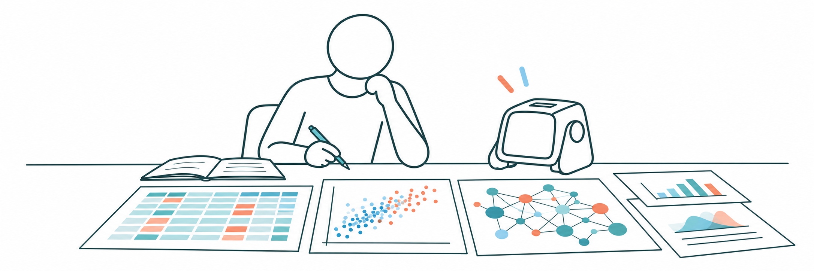

# Awesome Human-Agent Collaboration in Data Science

**An experimental, living human-in-the-loop survey** of human-agent
collaboration in data science and complex analytical workflows.

We connect papers, benchmarks, research landscapes, and traceable failure
evidence across ML, NLP, and HCI. The collection evolves through LLM-assisted
screening and synthesis, guided by human selection and interpretation.

## Explore

**[Visit the survey](https://jjydxfs-lab.github.io/awesome-human-agent-collaboration-in-data-science/)**

| Section | What you will find |
| --- | --- |
| [Papers](https://jjydxfs-lab.github.io/awesome-human-agent-collaboration-in-data-science/pages/papers.html) | Searchable candidates, abstracts, and screening rationale |
| [Benchmarks](https://jjydxfs-lab.github.io/awesome-human-agent-collaboration-in-data-science/pages/benchmarks.html) | Datasets and evaluation resources introduced or extended by papers |
| [Coverage](https://jjydxfs-lab.github.io/awesome-human-agent-collaboration-in-data-science/pages/conferences.html) | Candidate distributions and corpus coverage by venue and year |
| [Research Space](https://jjydxfs-lab.github.io/awesome-human-agent-collaboration-in-data-science/pages/stage5_research_space_3d.html) | A 3D view of selected papers and their citation relationships |
| [Challenges](https://jjydxfs-lab.github.io/awesome-human-agent-collaboration-in-data-science/pages/cluster_visual_space.html) | Challenge clusters, supporting evidence, and temporal views |

Coverage spans **2023-2026** across ICML, ACL, ICLR, EMNLP, NeurIPS, COLM,
and CHI, with selected preprints. The current deep-analysis snapshot contains
**81 papers, 639 evidence rows, and 20 challenge clusters**.

## A Work in Progress

This is a research resource, not a completed systematic review. Coverage is
uneven; LLM-generated labels and interpretations may contain errors and have
not all been manually verified. Counts and trends describe this collection,
not the whole field. Follow the evidence and original papers when citing findings.

This repository contains only the static website. Methodology and further
limitations are available on the site; credentials and working PDF/text caches
are not included.

---

Maintained by [@JJYDXFS](https://jjydxfs.github.io/), in collaboration with
Codex. Please credit original paper authors for their work. Bundled libraries
retain their own license notices.
