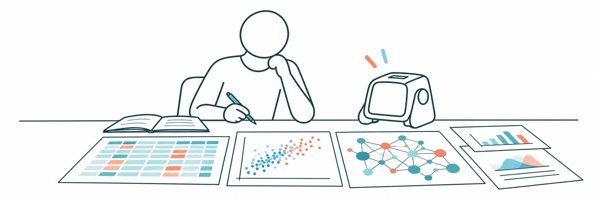

# Awesome Human-Agent Collaboration in Data Science<br>[](https://awesome.re)

[](https://jjydxfs-lab.github.io/awesome-human-agent-collaboration-in-data-science/)
[](LICENSE.md#survey-content-cc-by-40)
[](LICENSE.md#website-code-mit)



**A living, human-curated and LLM-assisted survey** of human-agent collaboration
in data science and complex analytical workflows.

**[Explore the interactive survey](https://jjydxfs-lab.github.io/awesome-human-agent-collaboration-in-data-science/)**
for paper search, benchmarks, coverage, Research Space, and evidence-backed challenges.

## Contents

- [Selected Papers](#selected-papers)
  - [Machine Learning (ML)](#machine-learning-ml)
  - [Natural Language Processing (NLP)](#natural-language-processing-nlp)
  - [Human-Computer Interaction (HCI)](#human-computer-interaction-hci)
- [Relevant Surveys](#relevant-surveys)
- [Related Collections](#related-collections)
- [Contribute](#contribute)

## Selected Papers

Selected papers from [Research Space](https://jjydxfs-lab.github.io/awesome-human-agent-collaboration-in-data-science/pages/stage5_research_space_3d.html),
including published work and selected preprints. Browse by machine learning,
natural language processing, and human-computer interaction,
with papers ordered newest first within each community.

### Machine Learning (ML)

#### 2026

- [](<https://openreview.net/forum?id=KxOlRNsRDG>) [**$R^3$DAO: Reactive Recovery and Reconstruction for Long-horizon Data Agent Orchestration**](<https://openreview.net/forum?id=KxOlRNsRDG>)
  R3DAO is a near-core autonomous data-science agent method that improves long-horizon workflow reliability through hierarchical planning and localized runtime recovery, offering strong methodological clues for later human-agent oversight designs.

- [](<https://openreview.net/forum?id=qkGykXowMU>) [**A Diagnostic Failure Taxonomy and Trajectory Critic for Data Agent Improvement**](<https://openreview.net/forum?id=qkGykXowMU>)
  This paper maps how autonomous data-analysis agents fail across planning, data, method, execution, insight, and communication stages, then uses that taxonomy to build a runtime critic that detects and corrects cascading failures in Planner-Actor workflows.

- [](<https://openreview.net/forum?id=IKVUB9Exuc>) [**Adaptive Collaboration with Humans: Metacognitive Policy Optimization for Multi-Agent LLMs with Continual Learning**](<https://openreview.net/forum?id=IKVUB9Exuc>)
  A near-core HITL multi-agent method paper that formalizes learned handoff to human expertise and continual learning from interventions, but validates it only on non-data-science reasoning benchmarks with simulated humans.

- [](<https://arxiv.org/abs/2603.19005>) [**AgentDS Technical Report: Benchmarking the Future of Human-AI Collaboration in Domain-Specific Data Science,**](<https://arxiv.org/abs/2603.19005>)
  AgentDS is a core benchmark paper showing that in domain-specific data science, the best results come from human-led, AI-assisted workflows rather than autonomous agents.

- [](<https://arxiv.org/abs/2605.09698>) [**Ambig-DS: A Benchmark for Task-Framing Ambiguity in Data-Science Agents**](<https://arxiv.org/abs/2605.09698>)
  A core data-science agent benchmark showing that agents often silently misframe underspecified tasks and that the real bottleneck is calibrated clarification, not pipeline execution.

- [](<https://arxiv.org/abs/2606.25996>) [**Autodata: An agentic data scientist to create high quality synthetic data**](<https://arxiv.org/abs/2606.25996>)
  Autodata proposes an autonomous multi-agent 'data scientist' that iteratively generates and judges synthetic data, showing strong gains for training-data creation but offering only indirect insight into human-agent collaboration because humans are mostly outside the loop.

- [](<https://openreview.net/forum?id=GR335S9IgZ>) [**CentaurEval: Benchmarking Human-in-the-Loop Value in Agentic Coding**](<https://openreview.net/forum?id=GR335S9IgZ>)
  A core benchmark paper showing that carefully designed collaboration-necessary coding tasks can quantify when human-AI teams outperform either humans or agents alone, with evidence for mixed-initiative co-reasoning.

- [](<https://openreview.net/forum?id=TUcgDjfdVk>) [**CoDA-Bench: Can Code Agents Handle Data-Intensive Tasks?**](<https://openreview.net/forum?id=TUcgDjfdVk>)
  CoDA-Bench is a core data-science benchmark showing that autonomous code agents struggle with realistic end-to-end analysis when they must both discover relevant data and write correct code in large noisy file systems.

- [](<https://openreview.net/forum?id=M4RKeHIAxw>) [**CoDA: Agentic Systems for Collaborative Data Visualization**](<https://openreview.net/forum?id=M4RKeHIAxw>)
  A strong autonomous multi-agent data-visualization paper that is useful for data-science agent workflow context, but not a core human-agent collaboration paper.

- [](<https://openreview.net/forum?id=GDYueXtKXT>) [**Collaborative Gym: A Framework for Enabling and Evaluating Human-Agent Collaboration**](<https://openreview.net/forum?id=GDYueXtKXT>)
  A core benchmark/framework paper that makes human-agent collaboration measurable and designable via dual-control, non-turn-taking shared-task environments, with strong relevance to data-analysis workflows.

- [](<https://openreview.net/forum?id=P479BoN8BD>) [**CoMind: Towards Community-Driven Agents for Machine Learning Engineering**](<https://openreview.net/forum?id=P479BoN8BD>)
  A strong data-science-agent benchmark/method paper showing that autonomous multi-agent ML engineers improve by exploiting simulated Kaggle community knowledge, but it is only indirectly about human-agent collaboration.

- [](<https://openreview.net/forum?id=r231Adxjfl>) [**COMPASS: Benchmarking Constrained Optimization in LLM Agents**](<https://openreview.net/forum?id=r231Adxjfl>)
  COMPASS is a core interactive-agent benchmark showing that frontier LLM agents can often satisfy user constraints but still fail to strategically search for utility-optimal solutions in multi-turn, tool-mediated decision tasks.

- [](<https://doi.org/10.1145/3788853.3803099>) [**ConDABench: Interactive Evaluation of Language Models for Data Analysis**](<https://doi.org/10.1145/3788853.3803099>)
  ConDABench is a core benchmark and evaluation framework for testing whether language-model agents can carry out realistic, mixed-initiative conversational data analysis under ambiguity and over longer interactions.

- [](<https://openreview.net/forum?id=EtzJy9yI5J>) [**DAComp: Benchmarking Data Agents across the Full Data Intelligence Lifecycle**](<https://openreview.net/forum?id=EtzJy9yI5J>)
  DAComp is a strong core benchmark for autonomous enterprise data agents because it covers both repository-level data engineering and open-ended analysis, but it is only indirectly relevant to the survey’s human-agent division-of-labor focus.

- [](<https://openreview.net/forum?id=eJV3JhJvZF>) [**DARE-bench: Evaluating Modeling and Instruction Fidelity of LLMs in Data Science**](<https://openreview.net/forum?id=eJV3JhJvZF>)
  DARE-bench is a large, verifiable benchmark and training resource for autonomous data-science agents that separates instruction-faithful workflow execution from outcome-oriented modeling under realistic tool and runtime constraints.

- [](<https://openreview.net/forum?id=tcPZvRXQhX>) [**DeepAnalyze: Agentic Large Language Models for Autonomous Data Science**](<https://openreview.net/forum?id=tcPZvRXQhX>)
  A near-core method paper that advances fully autonomous data-science agents through curriculum-based agentic training, useful mainly as the autonomy baseline/contrast for research on human-AI division of labor in analytical work.

- [](<https://openreview.net/forum?id=2WrNPRW9Km>) [**DSGym: A Holistic Framework for Evaluating and Training Data Science Agents**](<https://openreview.net/forum?id=2WrNPRW9Km>)
  DSGym is a core benchmark/framework paper for executable data-science agents that standardizes evaluation and training while exposing key failure modes like shortcut exploitation, weak verification, and domain-grounding errors.

- [](<https://openreview.net/forum?id=QKy6cKEiEB>) [**EnterpriseOps-Gym: Environments and Evaluations for Stateful Agentic Planning and Tool Use in Enterprise Settings**](<https://openreview.net/forum?id=QKy6cKEiEB>)
  A realistic enterprise benchmark showing that autonomous tool-using agents fail mainly on long-horizon, policy-constrained planning and safe refusal, with human plans dramatically improving outcomes.

- [](<https://openreview.net/forum?id=fVso2kGVrF>) [**Explanations are a Means to an End: Decision Theoretic Explanation Evaluation**](<https://openreview.net/forum?id=fVso2kGVrF>)
  A decision-theoretic evaluation framework for judging whether explanations can and do improve human-AI decision quality beyond baseline human judgment.

- [](<https://openreview.net/forum?id=HBXUC3YtP4>) [**Exposing Weaknesses of Large Reasoning Models through Graph Algorithm Problems**](<https://openreview.net/forum?id=HBXUC3YtP4>)
  A core graph-benchmark paper showing that LRMs struggle on scalable graph algorithm tasks due to long-context, execution, memory, and self-verification failures, while tools can largely rescue performance.

- [](<https://openreview.net/forum?id=dc8Kf2g0KC>) [**GraphOmni: A Comprehensive and Extensible Benchmark Framework for Large Language Models on Graph-theoretic Tasks**](<https://openreview.net/forum?id=dc8Kf2g0KC>)
  GRAPH OMNI is a strong graph-theoretic benchmark showing that LLM performance on non-graph-ML graph tasks depends heavily on representation and prompting, with major residual reasoning failures.

- [](<https://openreview.net/forum?id=NooBkSo7oz>) [**Hunt Instead of Wait: Evaluating Deep Data Research on Large Language Models**](<https://openreview.net/forum?id=NooBkSo7oz>)
  DDR-Bench is a strong benchmark for autonomous exploratory data analysis agents, especially for long-horizon investigation and verifiable insight extraction, but it is not a human-agent collaboration paper.

- [](<https://openreview.net/forum?id=fZfUdeCC5X>) [**KRAMABENCH: A Benchmark for AI Systems on Data-to-Insight Pipelines over Data Lakes**](<https://openreview.net/forum?id=fZfUdeCC5X>)
  A realistic benchmark for autonomous data-to-insight pipelines over messy data lakes that is highly relevant to data-science agent evaluation but only indirectly relevant to human-agent collaboration.

- [](<https://openreview.net/forum?id=ao3zijumY7>) [**LLM-Based Multi-Agent Blackboard System for Information Discovery in Data Science**](<https://openreview.net/forum?id=ao3zijumY7>)
  A blackboard-based autonomous data-science system replaces explicit specialist routing with self-selected contributions, providing a method reference for coordination and discovery rather than direct evidence about human-agent collaboration.

- [](<https://openreview.net/forum?id=jHDZEUgS4r>) [**MedAgentGym: A Scalable Agentic Training Environment for Code-Centric Reasoning in Biomedical Data Science**](<https://openreview.net/forum?id=jHDZEUgS4r>)
  A strong benchmark/training-environment paper for autonomous biomedical data-science agents that is highly relevant to code-centric analytical workflows but only indirectly relevant to human-agent collaboration.

- [](<https://openreview.net/forum?id=EBaBxJgxli>) [**Reinforcing Real-world Service Agents: Balancing Utility and Cost in Task-oriented Dialogue**](<https://openreview.net/forum?id=EBaBxJgxli>)
  A useful boundary paper on autonomous service-dialogue agents that balance satisfaction and cost, but it is outside the core survey focus on human-AI division of labor in complex analytical workflows.

- [](<https://openreview.net/forum?id=5PxFqpIYWC>) [**Scaling Generalist Data-Analytic Agents**](<https://openreview.net/forum?id=5PxFqpIYWC>)
  A strong method paper on scaling autonomous data-analysis agents via synthetic trajectory generation and hybrid SFT/RL, useful for data-science-agent context but not for human-agent division-of-labor questions.

- [](<https://openreview.net/forum?id=fHsVNklKOc>) [**Talk, Evaluate, Diagnose: User-aware Agent Evaluation with Automated Error Analysis**](<https://openreview.net/forum?id=fHsVNklKOc>)
  TED is a core user-aware agent benchmark framework that measures how different user expertise profiles affect multi-turn agent performance and diagnoses failures via automated error analysis.

- [](<https://bauplanlabs.github.io/SAO-workshop/papers/48.pdf>) [**TexeraAgent: An AI-Agent for Data Science Using Dataflows**](<https://bauplanlabs.github.io/SAO-workshop/papers/48.pdf>)
  TexeraAgent makes versioned executable dataflows the shared medium for human oversight and correction of a data-science agent, with preliminary autonomous benchmark gains but no measured collaboration outcomes.

- [](<https://openreview.net/forum?id=rp2RDBRA0Y>) [**The Value of Information in Human-AI Decision-making**](<https://openreview.net/forum?id=rp2RDBRA0Y>)
  A decision-theoretic human-AI collaboration paper that measures complementary information between humans and AI and shows explanation designs can improve team performance, making it methodologically relevant to labor division but not central to data-science or graph-agent workflows.

- [](<https://openreview.net/forum?id=jzp29vOA6c>) [**Training Proactive and Personalized LLM Agents**](<https://openreview.net/forum?id=jzp29vOA6c>)
  This paper is a core human-agent collaboration method that trains LLM agents to balance task success with proactive clarification and personalized interaction using simulated users and multi-objective RL.

- [](<https://openreview.net/forum?id=XHH1MUulfY>) [**VeriGraph: Towards Verifiable Data-Analytic Agents**](<https://openreview.net/forum?id=XHH1MUulfY>)
  VeriGraph makes autonomous data analysis more auditable through executable evidence graphs, providing a strong method foundation for oversight without demonstrating human-agent collaboration.

- [](<https://openreview.net/forum?id=7cHhcrbr6x>) [**WebDS: An End-to-End Benchmark for Web-based Data Science**](<https://openreview.net/forum?id=7cHhcrbr6x>)
  WebDS is a strong reference benchmark for realistic autonomous web-based data science, especially useful for understanding workflow complexity and human-agent performance gaps, but it is not itself a human-agent collaboration paper.

#### 2025

- [](<https://openreview.net/forum?id=flKhxGTBj2>) [**Are Large Language Models Ready for Multi-Turn Tabular Data Analysis?**](<https://openreview.net/forum?id=flKhxGTBj2>)
  A core benchmark paper for conversational tabular data analysis that operationalizes multi-turn clarification and feedback in data-science workflows, while offering only simulated rather than fully real human-agent collaboration evidence.

- [](<https://openreview.net/forum?id=DSsSPr0RZJ>) [**DSBench: How Far Are Data Science Agents from Becoming Data Science Experts?**](<https://openreview.net/forum?id=DSsSPr0RZJ>)
  DSBench is a strong end-to-end benchmark for realistic autonomous data science agents, valuable for mapping current automation limits in analytical workflows but not for studying collaborative human-agent labor directly.

- [](<https://openreview.net/forum?id=EiSXjzgBK4>) [**Flow-of-Options: Diversified and Improved LLM Reasoning by Thinking Through Options**](<https://openreview.net/forum?id=EiSXjzgBK4>)
  A strong autonomous DS/ML agent method paper that is useful for positioning data-science agents and benchmarking assumptions, but peripheral to a survey on human-AI division of labor.

- [](<https://arxiv.org/abs/2407.00379>) [**GraphArena: Evaluating and Exploring LLMs on Graph Computation**](<https://arxiv.org/abs/2407.00379>)
  GraphArena is a core graph-reasoning benchmark that matters for this survey because it operationalizes verification-sensitive failure modes and shows when LLM agents need tools, checkers, or oversight on complex structured tasks.

- [](<https://arxiv.org/abs/2505.18223>) [**IDA-Bench: Evaluating LLMs on Interactive Guided Data Analysis**](<https://arxiv.org/abs/2505.18223>)
  IDA-Bench is a core benchmark paper for studying whether data-analysis agents can follow evolving human guidance across multi-turn analytical workflows rather than merely solve static one-shot tasks.

- [](<https://openreview.net/forum?id=ZGqd0cbBvm>) [**InsightBench: Evaluating Business Analytics Agents Through Multi-Step Insight Generation**](<https://openreview.net/forum?id=ZGqd0cbBvm>)
  InsightBench is a core data-science benchmark paper that evaluates autonomous agents on full business-analytics workflows from high-level goals to actionable insight summaries, but it does not address human-agent collaboration directly.

- [](<https://openreview.net/forum?id=BwR8t91yqh>) [**Interactive Speculative Planning: Enhance Agent Efficiency through Co-design of System and User Interface**](<https://openreview.net/forum?id=BwR8t91yqh>)
  A mixed-initiative agent planning method that reduces latency by combining speculative backend planning with an interruptible UI, making it a strong HAI method reference but not an application-specific analytics benchmark.

#### 2024

- [](<https://arxiv.org/abs/2409.19667>) [**Can Large Language Models Analyze Graphs like Professionals? A Benchmark, Datasets and Models**](<https://arxiv.org/abs/2409.19667>)
  A core graph-benchmark paper that operationalizes 'professional' graph analysis as tool-using code generation, showing current LLM agents are weak without retrieval/fine-tuning and thereby clarifying the boundary between autonomous graph agents and real expert practice.

- [](<https://openreview.net/forum?id=LfJgeBNCFI>) [**DS-Agent: Automated Data Science by Empowering Large Language Models with Case-Based Reasoning**](<https://openreview.net/forum?id=LfJgeBNCFI>)
  DS-Agent is a strong autonomous data-science agent method that uses case-based reasoning and execution feedback to improve ML workflow performance, but it offers little insight into human-agent division of labor.

- [](<https://openreview.net/forum?id=BqEvdOS1Hs>) [**Enhancing Human Experience in Human-Agent Collaboration: A Human-Centered Modeling Approach Based on Positive Human Gain**](<https://openreview.net/forum?id=BqEvdOS1Hs>)
  A human-centered RL method trains collaborative agents to provide baseline-relative, effective assistance to human partners, avoiding over-assistance that harms task competence.

- [](<https://openreview.net/forum?id=d5LURMSfTx>) [**InfiAgent-DABench: Evaluating Agents on Data Analysis Tasks**](<https://openreview.net/forum?id=d5LURMSfTx>)
  A foundational benchmark paper for autonomous data-analysis agents that evaluates end-to-end CSV analysis with tool use and self-debug, but offers little on human-agent division of labor.

- [](<https://openreview.net/forum?id=sKATR2O1Y0>) [**OpenAgents: An Open Platform for Language Agents in the Wild**](<https://openreview.net/forum?id=sKATR2O1Y0>)
  OpenAgents is a near-core platform paper that matters less as a collaboration theory contribution and more as deployable infrastructure for studying real-user, in-the-wild interaction with data, tool, and web agents.

- [](<https://openreview.net/forum?id=gjoUXwuZdy>) [**VisionGraph: Leveraging Large Multimodal Models for Graph Theory Problems in Visual Context**](<https://openreview.net/forum?id=gjoUXwuZdy>)
  A core graph-benchmark paper that evaluates LMMs on visual graph-theory tasks and shows that tool-augmented decomposition helps, while exposing major perception and reasoning failure modes.

#### 2023

- [](<https://openreview.net/forum?id=q8SukwaEBy>) [**Learning from Active Human Involvement through Proxy Value Propagation**](<https://openreview.net/forum?id=q8SukwaEBy>)
  A human-in-the-loop RL paper on active intervention and corrective demonstration, useful for oversight/handoff concepts but peripheral to data-science agent collaboration.

- [](<https://openreview.net/forum?id=q3F0UBAruO>) [**Towards Effective and Interpretable Human-Agent Collaboration in MOBA Games: A Communication Perspective**](<https://openreview.net/forum?id=q3F0UBAruO>)
  A strong mixed-initiative human-agent collaboration paper showing that interpretable structured communication and value-based command selection improve teamwork in MOBA games, but it is mainly a domain-transfer reference rather than a core paper for data-analysis agents.

### Natural Language Processing (NLP)

#### 2026

- [](<https://aclanthology.org/2026.findings-emnlp.1027/>) [**DSFlow: Evolutionary Workflow Optimization for Generalizable LLM-Based Data Science Automation**](<https://aclanthology.org/2026.findings-emnlp.1027/>)
  DSFlow is a core-seed autonomous data-science method reference that learns transferable operator workflows and offers a structural foundation for studying where human oversight should enter.

- [](<https://aclanthology.org/2026.findings-acl.1250/>) [**Evolving Agentic Workflow Driven by Human-Agent Collaboration**](<https://aclanthology.org/2026.findings-acl.1250/>)
  HFlow is a human-preference-guided evolutionary method for automatically designing adaptive multi-agent workflows, useful as a core method reference for human-guided division of labor in agent workflow construction.

- [](<https://aclanthology.org/2026.acl-long.1328/>) [**From Knowing to Teaching: Scaffolding Pedagogical Decisions for LLM Agent**](<https://aclanthology.org/2026.acl-long.1328/>)
  A lesson-generation agent paper that is useful as an analog for structured task decomposition and benchmark design, but peripheral to human-AI collaboration in real-world analytical workflows.

- [](<https://aclanthology.org/2026.findings-acl.1651/>) [**GraphMind: LLM s as Dynamic Knowledge Builders for Sequential Decision-Making**](<https://aclanthology.org/2026.findings-acl.1651/>)
  GraphMind shows how an LLM agent can build and use a dynamic knowledge graph as external memory to improve long-horizon planning under partial observability.

- [](<https://aclanthology.org/2026.acl-long.441/>) [**IEvoAgent: Evolving Conversational Agent based on User Implicit Feedback**](<https://aclanthology.org/2026.acl-long.441/>)
  A near-core HAI method paper showing how an agent can adapt online to users’ implicit feedback across multi-turn conversations via a dynamic response-feedback model and prompt-level policy evolution.

- [](<https://aclanthology.org/2026.findings-acl.1729/>) [**InsightEval: An Expert-Curated Benchmark for Assessing Insight Discovery in LLM-Driven Data Agents**](<https://aclanthology.org/2026.findings-acl.1729/>)
  InsightEval is a core data-science agent benchmark that improves InsightBench with expert-curated tabular insight tasks and evaluates agents by precision, recall, F1, summary quality, and novelty rather than simple ground-truth matching.

- [](<https://aclanthology.org/2026.emnlp-main.584/>) [**LongDS-Bench: On the Failure of Long-Horizon Agentic Data Analysis**](<https://aclanthology.org/2026.emnlp-main.584/>)
  A core data-analysis benchmark paper showing that autonomous agents struggle badly with long-horizon analytical state management, making it strong motivation and evaluation context for human oversight and recovery mechanisms.

- [](<https://aclanthology.org/2026.findings-acl.1506/>) [**PrefIx: Understand and Adapt to User Preference in Human-Agent Interaction**](<https://aclanthology.org/2026.findings-acl.1506/>)
  PrefIx is a core human-agent interaction benchmark that makes interaction quality measurable by treating confirmations, explanations, pacing, and related behaviors as structured tools and evaluating preference alignment alongside task accuracy.

- [](<https://aclanthology.org/2026.acl-long.1039/>) [**SPIO : Ensemble and Selective Strategies via LLM -Based Multi-Agent Planning in Automated Data Science**](<https://aclanthology.org/2026.acl-long.1039/>)
  SPIO is a strong autonomous multi-agent method for tabular automated data science that improves pipeline performance via module-wise multi-path planning and selection/ensembling, but it does not tackle human-agent collaboration directly.

- [](<https://aclanthology.org/2026.findings-emnlp.1279/>) [**Structured Strategy Injection for Data Analysis Agents**](<https://aclanthology.org/2026.findings-emnlp.1279/>)
  A method reference for turning expert analytical procedures into agent-executable playbooks and auditable checkpoints, with benchmark gains but no demonstrated interactive human oversight.

- [](<https://aclanthology.org/2026.findings-acl.159/>) [**Towards Proactive Personalization through Profile Customization for Individual Users in Dialogues**](<https://aclanthology.org/2026.findings-acl.159/>)
  This paper proposes a lifelong personalized dialogue agent that incrementally infers user preferences as an MDP, stores them in a persistent profile, and proactively asks for missing information in cold-start scenarios.

- [](<https://aclanthology.org/2026.findings-acl.783/>) [**Tree-Notebook: A Context-Aware Agent with Tree Search and Entropy-Aware Data Shadow for Interactive Data Science**](<https://aclanthology.org/2026.findings-acl.783/>)
  Tree-Notebook is a core data-science agent method that uses tree-structured notebook execution, Data Shadow state tracking, and rollback-based recovery to make autonomous analysis workflows more robust against silent failures and dead ends.

- [](<https://aclanthology.org/2026.acl-long.1556/>) [**UniDataBench: Evaluating Data Analytics Agents Across Structured and Unstructured Data**](<https://aclanthology.org/2026.acl-long.1556/>)
  A core data-science benchmark paper that expands agent evaluation from single-format tabular analysis to realistic multi-source structured/unstructured analytics, but with minimal attention to interactive human-agent collaboration.

#### 2025

- [](<https://aclanthology.org/2025.findings-emnlp.539/>) [**AIRepr: An Analyst-Inspector Framework for Evaluating Reproducibility of LLM s in Data Science**](<https://aclanthology.org/2025.findings-emnlp.539/>)
  A useful near-core reference that reframes oversight in LLM-based data analysis as automated workflow reproducibility checking, but is primarily an evaluation framework rather than a human-agent collaboration study.

- [](<https://aclanthology.org/2025.emnlp-main.466/>) [**Can LLM s Help You at Work? A Sandbox for Evaluating LLM Agents in Enterprise Environments**](<https://aclanthology.org/2025.emnlp-main.466/>)
  A useful boundary benchmark paper that defines a realistic enterprise task landscape for autonomous LLM agents, but is not a core paper on human-agent collaboration or division of labor.

- [](<https://aclanthology.org/2025.naacl-demo.17/>) [**CowPilot: A Framework for Autonomous and Human-Agent Collaborative Web Navigation**](<https://aclanthology.org/2025.naacl-demo.17/>)
  CowPilot is a mixed-initiative web-agent framework that operationalizes human oversight, intervention, and handoff, showing that small amounts of human correction can dramatically improve agent task success.

- [](<https://aclanthology.org/2025.findings-acl.1016/>) [**Data Interpreter: An LLM Agent for Data Science**](<https://aclanthology.org/2025.findings-acl.1016/>)
  A strong core data-science-agent paper that models analytical workflows as hierarchical graphs with runtime verification and replanning, useful more for defining autonomous DS workflow structure and failure recovery than for studying human-agent collaboration directly.

- [](<https://aclanthology.org/2025.emnlp-main.58/>) [**Datawise Agent: A Notebook-Centric LLM Agent Framework for Adaptive and Robust Data Science Automation**](<https://aclanthology.org/2025.emnlp-main.58/>)
  A strong autonomous data science agent paper that matters for notebook-based workflow design and failure recovery, but serves more as a method reference than as direct evidence on human-agent division of labor.

- [](<https://aclanthology.org/2025.acl-long.1202/>) [**Graph Counselor: Adaptive Graph Exploration via Multi-Agent Synergy to Enhance LLM Reasoning**](<https://aclanthology.org/2025.acl-long.1202/>)
  A strong graph-reasoning method paper: it advances autonomous multi-agent GraphRAG and uses GRBENCH, but is only indirectly relevant to human-agent collaboration because all coordination is AI-internal.

- [](<https://aclanthology.org/2025.acl-long.206/>) [**Leveraging Dual Process Theory in Language Agent Framework for Real-time Simultaneous Human- AI Collaboration**](<https://aclanthology.org/2025.acl-long.206/>)
  A core HAI method paper proposing a dual-process agent architecture for real-time simultaneous collaboration, valuable for reasoning about labor division and coordination under latency constraints but only indirectly relevant to data science.

- [](<https://aclanthology.org/2025.emnlp-main.973/>) [**MA - GTS : A Multi-Agent Framework for Solving Complex Graph Problems in Real-World Applications**](<https://aclanthology.org/2025.emnlp-main.973/>)
  MA-GTS is an autonomous multi-agent LLM system that parses noisy natural-language graph problems, selects and executes graph algorithms, and is evaluated on the new G-REAL graph-problem benchmark.

- [](<https://aclanthology.org/2025.emnlp-main.12/>) [**Preemptive Detection and Correction of Misaligned Actions in LLM Agents**](<https://aclanthology.org/2025.emnlp-main.12/>)
  A selective-oversight framework that detects likely user-intent misalignment before high-stakes agent actions and hands control to humans for verification and correction.

- [](<https://aclanthology.org/2025.acl-long.1017/>) [**Substance over Style: Evaluating Proactive Conversational Coaching Agents**](<https://aclanthology.org/2025.acl-long.1017/>)
  A useful boundary paper showing that in proactive mixed-initiative dialogue, users prefer facilitative agents with strong substantive task support, and that expert/LM evaluations can diverge sharply from user judgments.

#### 2024

- [](<https://aclanthology.org/2024.findings-acl.548/>) [**Are LLM s Capable of Data-based Statistical and Causal Reasoning? Benchmarking Advanced Quantitative Reasoning with Data**](<https://aclanthology.org/2024.findings-acl.548/>)
  A useful near-core benchmark paper showing that autonomous LLM agents can execute some data-based statistical/causal analyses, but still fail badly at integrating domain knowledge with data—especially for causal reasoning.

- [](<https://aclanthology.org/2024.acl-long.308/>) [**Benchmarking Data Science Agents**](<https://aclanthology.org/2024.acl-long.308/>)
  A core data-science-agent benchmark paper that evaluates agents over realistic notebook-style analytical workflows, emphasizing lifecycle monitoring, context handling, error propagation, intactness, and self-repair rather than human collaboration per se.

- [](<https://aclanthology.org/2024.emnlp-main.748/>) [**DA-Code: Agent Data Science Code Generation Benchmark for Large Language Models**](<https://aclanthology.org/2024.emnlp-main.748/>)
  DA-Code is a strong executable benchmark for autonomous end-to-end data-science code agents, valuable for task and evaluation design but only indirectly relevant to human-agent collaboration.

- [](<https://aclanthology.org/2024.acl-long.61/>) [**Tell Me More! Towards Implicit User Intention Understanding of Language Model Driven Agents**](<https://aclanthology.org/2024.acl-long.61/>)
  An interaction-centric agent paper that benchmarks and improves an LLM agent’s ability to ask clarifying questions and convert vague user requests into explicit executable goals before autonomous action.

- [](<https://doi.org/10.1145/3626772.3657843>) [**Towards Human-centered Proactive Conversational AI**](<https://doi.org/10.1145/3626772.3657843>)
  A human-centered perspective paper that reframes proactive conversational agents around mixed initiative, adaptivity, civility, trust, and user control rather than pure task efficiency.

#### 2023

- [](<https://aclanthology.org/2023.findings-emnlp.637/>) [**Is GPT-4 a Good Data Analyst?**](<https://aclanthology.org/2023.findings-emnlp.637/>)
  An early core paper for data-science agents that defines and evaluates GPT-4 as an end-to-end data analyst, useful more for task framing and benchmark design than for interaction design.

### Human-Computer Interaction (HCI)

#### 2026

- [](<https://dl.acm.org/doi/10.1145/3772318.3790802>) [**"I Need to Find That One Chart": How Data Workers Navigate, Summarize and Communicate Analytical Conversations**](<https://dl.acm.org/doi/10.1145/3772318.3790802>)
  A CHI study of data workers revisiting LLM-based analytical chats finds that users want AI to scaffold navigation and summary drafting, while humans keep control over selection, framing, and final communication.

- [](<https://dl.acm.org/doi/10.1145/3772318.3791673>) [**Cocoa: Co-Planning and Co-Execution with AI Agents**](<https://dl.acm.org/doi/10.1145/3772318.3791673>)
  Cocoa is a core human-agent collaboration paper showing that interleaving shared planning with shared execution can improve steerability and practical delegation in complex research workflows.

- [](<https://dl.acm.org/doi/10.1145/3772318.3790441>) [**DuetUI: A Bidirectional Context Loop for Human-Agent Co-Generation of Task-Oriented Interfaces**](<https://dl.acm.org/doi/10.1145/3772318.3790441>)
  DuetUI is a CHI interface prototype showing how mixed-initiative human-agent co-generation can use direct manipulation as implicit feedback to continuously reshape a task-oriented UI.

- [](<https://dl.acm.org/doi/10.1145/3772318.3791945>) [**Facilitating Proactive and Reactive Guidance for Decision Making on the Web: A Design Probe with WebSeek**](<https://dl.acm.org/doi/10.1145/3772318.3791945>)
  A CHI design-probe paper showing that data-centric, mixed-initiative web analysis can improve user agency and confidence by combining direct manipulation with proactive and reactive AI guidance.

- [](<https://dl.acm.org/doi/10.1145/3772318.3791600>) [**Feedback by Design: Understanding and Overcoming User Feedback Barriers in Conversational Agents**](<https://dl.acm.org/doi/10.1145/3772318.3791600>)
  A CHI position-and-study paper showing that human feedback to conversational agents fails due to recurring interaction barriers and that lightweight scaffolds can improve corrective collaboration, though at added cognitive cost.

- [](<https://arxiv.org/abs/2605.24521>) [**From Prompting to Verification: How Experience Shapes Vibe Coding Practices**](<https://arxiv.org/abs/2605.24521>)
  This paper shows that in AI-assisted coding, access to generation broadens across user groups, but effective verification and recovery remain experience-dependent, creating a perception–action gap central to human-agent work allocation.

- [](<https://dl.acm.org/doi/10.1145/3772318.3791665>) [**LAPS: Automating Hypothesis-Driven Statistical Analysis of Public Survey Using Large Language Models**](<https://dl.acm.org/doi/10.1145/3772318.3791665>)
  An HCI paper on a mixed-initiative LLM system for end-to-end survey-data statistical analysis, useful mainly as workflow-oriented human-AI collaboration background rather than a core benchmark or graph/data-science agent paper.

- [](<https://dl.acm.org/doi/10.1145/3772318.3791428>) [**Who Does What? Archetypes of Roles Assigned to LLMs During Human-AI Decision-Making**](<https://dl.acm.org/doi/10.1145/3772318.3791428>)
  A CHI taxonomy paper that organizes 17 recurring human-LLM decision-making role patterns and shows that role assignment materially changes outcomes, making it strong conceptual background for studying human-agent division of labor.

#### 2025

- [](<https://arxiv.org/abs/2506.09420>) [**A call for collaborative intelligence: Why human-agent systems should precede ai autonomy**](<https://arxiv.org/abs/2506.09420>)
  A 2025 position paper arguing that near-term progress should prioritize collaborative human-agent systems over fully autonomous LLM agents, with explicit guidance on roles, oversight, and evaluation.

- [](<https://arxiv.org/abs/2505.18422>) [**A task-driven human-AI collaboration: When to automate, when to collaborate, when to challenge**](<https://arxiv.org/abs/2505.18422>)
  A conceptual human-AI collaboration framework that assigns AI to autonomous, collaborative, or adversarial roles based on task risk, complexity, type, and stakeholder preferences, with explicit attention to agency and oversight.

- [](<https://dl.acm.org/doi/10.1145/3706598.3714135>) [**Dango: A Mixed-Initiative Data Wrangling System using Large Language Model**](<https://dl.acm.org/doi/10.1145/3706598.3714135>)
  Dango is a core human-AI collaboration paper showing how mixed-initiative clarification, explanation, and editable feedback can improve multi-table data wrangling accuracy and efficiency.

- [](<https://dl.acm.org/doi/10.1145/3706598.3713296>) [**Data Formulator 2: Iterative Creation of Data Visualizations, with AI Transforming Data Along the Way**](<https://dl.acm.org/doi/10.1145/3706598.3713296>)
  Df2 is a mixed-initiative visualization system that uses UI+NL inputs and branchable history to let analysts iteratively steer AI-generated data transformations during exploratory analysis.

- [](<https://dl.acm.org/doi/10.1145/3706598.3714044>) [**PlanTogether: Facilitating AI Application Planning Using Information Graphs and Large Language Models**](<https://dl.acm.org/doi/10.1145/3706598.3714044>)
  A CHI 2025 system paper on graph-structured, mixed-initiative LLM support for helping domain experts create actionable AI project plans before handing off to AI experts.

- [](<https://arxiv.org/abs/2505.00018>) [**Position paper: Towards open complex human-AI agents collaboration systems for problem solving and knowledge management**](<https://arxiv.org/abs/2505.00018>)
  A broad position paper proposing a formal, governance-centric framework for open complex human–AI collaboration, emphasizing human oversight, initiative budgeting, shared knowledge validation, and auditable reconfiguration.

- [](<https://dl.acm.org/doi/10.1145/3706598.3713484>) [**StructVizor: Interactive Profiling of Semi-Structured Textual Data**](<https://dl.acm.org/doi/10.1145/3706598.3713484>)
  StructVizor is a CHI visual analytics system where LLM-assisted structure extraction and mining support, but do not replace, human-led profiling and wrangling of messy semi-structured text.

#### 2024

- [](<https://dl.acm.org/doi/10.1145/3613904.3642497>) [**How Do Analysts Understand and Verify AI-Assisted Data Analyses?**](<https://dl.acm.org/doi/10.1145/3613904.3642497>)
  A CHI 2024 user study showing that analysts verify AI-generated data analyses by moving between procedure-oriented and data-oriented checks, revealing concrete oversight needs for AI analysis assistants.

- [](<https://dl.acm.org/doi/10.1145/3613904.3641891>) [**How Do Data Analysts Respond to AI Assistance? A Wizard-of-Oz Study**](<https://dl.acm.org/doi/10.1145/3613904.3641891>)
  A CHI Wizard-of-Oz study showing that data analysts value AI assistance beyond code completion, especially for planning and alternative reasoning, but only when initiative, timing, abstraction, and explanation are well aligned with human workflow.

- [](<https://dl.acm.org/doi/10.1145/3613904.3642120>) [**Mapping the Design Space of Teachable Social Media Feed Experiences**](<https://dl.acm.org/doi/10.1145/3613904.3642120>)
  A CHI design-space paper showing how non-expert users could teach social-media feed algorithms through IMT-style interfaces, mainly relevant as background on agency and teachable adaptive systems.


## Relevant Surveys

- [](<https://aclanthology.org/2026.findings-acl.1811/>) [**LLM-Based Human-Agent Collaboration and Interaction Systems: A Survey**](<https://aclanthology.org/2026.findings-acl.1811/>)
  Organizes human-agent systems around human feedback, interaction types, orchestration, communication, and applications.

- [](<https://aclanthology.org/2026.findings-emnlp.1645/>) [**Puzzles to Paradigms: A Survey of Human–Agent Collaboration in Scientific Innovation**](<https://aclanthology.org/2026.findings-emnlp.1645/>)
  Examines how humans and agents coordinate across scientific workflows, highlighting recurring failures and evaluation needs.

- [](<https://aclanthology.org/2026.findings-acl.1804/>) [**AI Agents for the Science of Science: A Survey of Tasks, Architectures, Evaluations, and Challenges**](<https://aclanthology.org/2026.findings-acl.1804/>)
  Distinguishes agents that simulate scientific communities from agents that support empirical analysis and research workflows.

- [](<https://dl.acm.org/doi/10.1145/3772318.3791428>) [**Who Does What? Archetypes of Roles Assigned to LLMs During Human-AI Decision-Making**](<https://dl.acm.org/doi/10.1145/3772318.3791428>)
  Combines a scoping review of 113 papers with clinical case evaluations to examine 17 human-LLM decision-making archetypes.

- [](<https://aclanthology.org/2025.emnlp-main.895/>) [**From Automation to Autonomy: A Survey on Large Language Models in Scientific Discovery**](<https://aclanthology.org/2025.emnlp-main.895/>)
  Maps scientific LLM systems onto Tool, Analyst, and Scientist roles to compare their autonomy and responsibilities.

- [](<https://dl.acm.org/doi/10.1145/3706598.3713551>) [**Unveiling High-dimensional Backstage: A Survey for Reliable Visual Analytics with Dimensionality Reduction**](<https://dl.acm.org/doi/10.1145/3706598.3713551>)
  Reviews reliability problems in dimensionality-reduction visual analytics, linking analyst-machine workflows to failure sources and remedies.

- [](<https://openreview.net/forum?id=ZT5SJQN0CS>) [**Large Language Model-based Data Science Agent: A Survey**](<https://openreview.net/forum?id=ZT5SJQN0CS>)
  Connects agent design choices with data science workflows, from preprocessing and modeling to evaluation and visualization.


## Related Collections

- [Supporting Our AI Overlords (SAO)](<https://bauplanlabs.github.io/SAO-workshop/>)
  Workshop at ACM CAIS 2026 (Conference on AI and Agentic Systems).

- [Co-Data: Cultivating Effective Human–LLM Collaboration for Collaborative Data Processing](<https://www.codata.design/>)
  Workshop at CHI.

## Contribute

The collection grows as we discover and review new work. Paper suggestions,
corrections, and useful resources
are welcome via [Issues](https://github.com/JJYDXFS-Lab/awesome-human-agent-collaboration-in-data-science/issues).
Include a paper or resource link and a corresponding short discussion. For corrections, identify the entry and the information to update. This list is also included in [Awesome Data Science](https://github.com/academic/awesome-datascience#other-awesome-lists:~:text=Awesome%20Human%2DAgent%20Collaboration%20in%20Data%20Science).
Explore their collection for broader data science resources.

List format inspired by [Awesome](https://github.com/sindresorhus/awesome)
and the [Awesome manifesto](https://github.com/sindresorhus/awesome/blob/main/awesome.md).

---

Maintained by [@JJYDXFS](https://jjydxfs.github.io/), in collaboration with Codex.
Please credit original paper authors. Bundled libraries retain their license notices.
Original content: CC BY 4.0. Original website code: MIT. See [licensing scope](LICENSE.md).
If useful, consider giving the repository [a star](https://github.com/JJYDXFS-Lab/awesome-human-agent-collaboration-in-data-science)
or citing the living survey:

```bibtex
@misc{jjydxfs2026humanagent,
  author = {{JJYDXFS}},
  title = {Awesome Human-Agent Collaboration in Data Science: A Living Survey},
  year = {2026},
  url = {https://jjydxfs-lab.github.io/awesome-human-agent-collaboration-in-data-science/},
  note = {Continuously updated; developed in collaboration with Codex}
}
```
